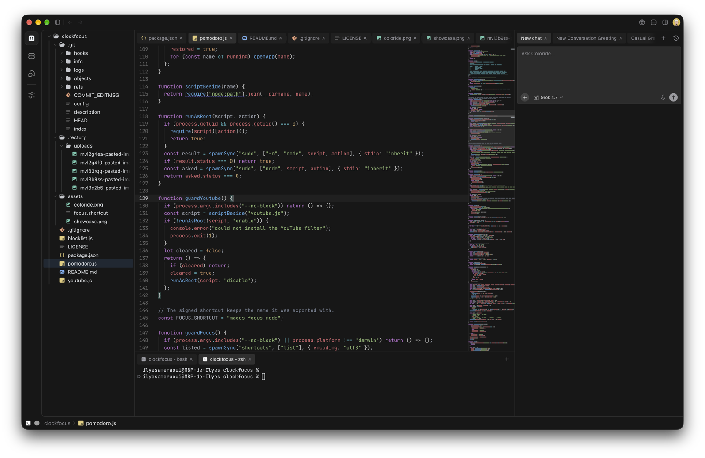

<div align="center">

# Coloride

**내 코드, 내 Mac. 하나의 IDE.**


<a href="./LICENSE"></a>


[English](README.md) · [中文](README.zh-CN.md) · [日本語](README.ja.md) · **한국어** · [Español](README.es.md) · [Français](README.fr.md) · [Português](README.pt.md) · [Deutsch](README.de.md) · [Italiano](README.it.md)



</div>

---
폴더를 열고 이 컴퓨터에서 코드, 터미널, 브라우저를 사용합니다. 이 경로는 Coloride 서버를 호출하지 않습니다.

Coloride는 상표입니다. MIT 라이선스는 소스 코드에 적용되며 이름, 로고, 도메인에는 적용되지 않습니다.

## 지금 되는 것

Coloride는 **Apple Silicon macOS**에서 동작합니다.

- **코드 편집:** 탐색기, 탭, CodeMirror 언어, 자동 완성, 진단, 검색, 이미지 미리 보기.
- **프로젝트 실행:** 작업 제어가 있는 로컬 터미널. 로컬 호스트가 살아있는 동안 세션이 유지됩니다.
- **결과 보기:** 내장 Chromium 브라우저와 별도 창. localhost는 이 컴퓨터를 가리킵니다.
- **빈 파일로 시작:** New File은 제목 없는 버퍼를 엽니다. 내용을 바꾸고 닫으면 저장할지 묻습니다.

로그인과 관리형 에이전트는 꺼져 있습니다. `coloride.dev`에는 아직 API가 없습니다. SSH 코드는 저장소에 남아 있고 화면에는 나오지 않습니다. [로드맵](./docs/roadmap.md)은 우선순위이며 끝난 작업이 아닙니다.

## 검사

아래 준비 후 저장소 루트에서 실행합니다.

```sh
corepack pnpm typecheck
core/ide-host/.venv/bin/python -m pytest core/ide-host/tests -q
```

화면 테스트는 [tests/README.md](./tests/README.md), 변경을 보내는 방법은 [CONTRIBUTING.md](./CONTRIBUTING.md)에 있습니다.

## 개발 및 문서

설정, 명령어 및 기여 규칙은 번역 간 불일치를 방지하기 위해 아래 가이드에서 관리합니다.

- [Coloride README](README.md)
- [아키텍처](README.md#architecture)
- [개발 시작](README.md#start-developing)
- [기여](CONTRIBUTING.md)
- [테스트](tests/README.md)
- [보안](SECURITY.md)
- [MIT 라이선스](LICENSE)
